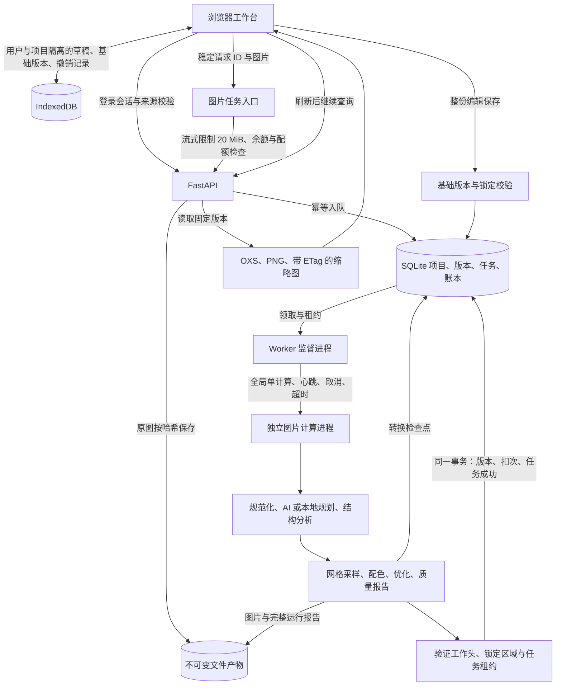

# 架构优化与 TDD 验证

日期：2026-09-13。对应[优化前审查](architecture-review-2026-09-13.md)，以下为当前工作区实际实现；保留了本轮开始前已有的账号、支付、图像分析等修改。

## 当前流程



## 改动与效果

| 问题 | 已实现行为 | 关键代码 |
|---|---|---|
| 整份保存绕过 locked | 在存储提交边界检查旧锁定区域；不能通过换配方材料、股数、针方向、网格、绣布或移除锁定来间接修改锁定针格 | `commands.py`、`sqlite.py` |
| 图片转换长请求、重复扣次风险 | 抽出转换服务，图片任务持久入队；稳定请求 ID 去重、独立计算、阶段进度、取消、超时、恢复。版本、扣次、任务成功原子提交 | `conversion.py`、`generation.py`、`worker.py`、`useGeneration.ts` |
| 刷新丢编辑、冲突无恢复入口 | IndexedDB 持久草稿和有上限的撤销／重做记录；基础版本冲突保留修改，允许另存或加载服务器版本。远端加载失败不删除草稿；旧异步响应不能切换其他项目的状态 | `drafts.ts`、`useProjectDraft.ts`、`App.tsx` |
| 缩略图重复生成、读请求争写锁 | 先鉴权再读取按版本缓存的缩略图，支持 ETag／304；中间件保留路由缓存策略。账号、账本、支付纯读取改为只读快照事务 | `thumbnails.py`、`app.py`、存储账号与支付模块 |
| 指针事件反复扫描大图 | 按动画帧合并画笔更新，松开时提交剩余针格；未保存状态 O(1) 查询，针数统计按补丁增量更新；复用符号表 | `editor.ts`、`strokeBatch.ts`、`PatternCanvas.tsx` |
| 转换报告无法完整追溯 | 保存输入选项、生效选项、来源与色库哈希、版本、转换／规划／结构分析实现文件哈希、报告及阶段耗时；图纸版本引用不可变 JSON 报告 | `conversion.py` |

本地草稿每个撤销／重做方向最多保存 100 步、累计 100 万个针格变更；超过容量时丢弃旧操作记录，保留完整草稿。已保存且无修改时删除草稿，服务端仍保留图纸版本。底部状态栏显示落盘状态，不改变画布高度。IndexedDB 草稿只存在于当前浏览器，不跨设备同步。

缩略图缓存最多 64 项、16 MiB，响应使用 `private, no-cache` 和 `Vary: Cookie`；源素材继续使用 `no-store`。未登录请求不能通过缓存或条件请求拿到缩略图。

报告的浮点测量值存于独立 JSON；图纸扩展仅存引用及整数毫秒摘要，兼容现有文档 Schema。记录的 `total` 为转换计算耗时，不包含最终数据库提交；文件哈希覆盖转换编排、规划和结构分析文件，不代表整个运行环境的完整可复现快照。

## 启动与恢复

```bash
uv sync
uv run stitchforge-api
```

该入口默认自动启动并管理 worker。单独管理进程时，在 `.env` 设置 `STITCHFORGE_WORKER_ENABLED=0`，分别运行 `uv run stitchforge-api` 和 `uv run stitchforge-worker`。两者必须共用 `STITCHFORGE_DATA_DIR` 与色库配置。`create_app()` 工厂默认不开 worker，测试或嵌入式调用需显式传入 `start_worker=True`。

| 限制 | 当前值 |
|---|---|
| 每账号图片在途任务 | 1 个 |
| 全局图片在途任务 | 32 个，含排队、计算和待取消 |
| 图片重型计算 | 同一数据目录最多 1 个；旧同步转换入口也受同一文件锁限制 |
| 租约／心跳 | 60 秒／5 秒 |
| 单次任务超时 | 600 秒，停止计算且不扣次数 |
| 上传 | 按实际流式接收字节限制 20 MiB；拒绝后不继续消费数据 |

SQLite schema 从版本 1 增量迁移到 2，新增请求幂等映射表，保留已有项目和版本。重启后可重新领取过期租约；已经完成的整体转换检查点可复用。尚未完成转换时会重新计算，不支持从每个数值计算阶段断点继续。过期 worker 的结果不能提交；取消与提交在存储层检查状态，取消不会允许迟到结果覆盖图纸。

文件计算锁使用 Unix `flock`，当前运行范围是 macOS／Linux 单机与本地文件系统。worker 只执行 `image_conversion`；通用任务接口的其他类型尚无执行器。

## TDD 记录

先运行新增回归用例确认失败，再补最小实现并重构。关键红灯包括：整份保存能够改锁定针格、读请求争用写锁、图片任务入口不存在、没有可运行 worker、刷新无法恢复草稿、编辑状态全图扫描，以及上传被余额拒绝后仍写入文件。

实现过程中通过浏览器回归补充了三项失败案例：草稿提示改变画布高度、加载服务器版本失败后提前删除本地草稿、返回图纸库重置状态导致草稿删除；均已修复并复验。

| 验证 | 结果 |
|---|---|
| `uv run pytest --tb=short` | 308 项通过；2 条现有测试依赖弃用提示 |
| `pnpm test`（`apps/web`） | 33 项通过，覆盖锁定、增量状态、实际 IndexedDB 事务、草稿隔离与冲突、画笔批处理 |
| `pnpm build`、`pnpm lint` | 通过 |
| `tools/check_web_recovery.py` | 刷新草稿、撤销恢复、冲突保留、服务器加载失败保护与显式恢复通过 |
| `tools/check_web_generation.py` | 入队、刷新查询不重复提交、打开结果、取消通过 |
| `tools/check_web_editing.py` | 查看／编辑、图例、原图对照、笔画、保存、选区、填色、撤销通过 |
| `tools/check_web_accounts.py` | 临时真实 API、后台 worker、账号隔离、生成扣次与账本、移动端、OXS／PNG 下载、失败保存重试通过 |
| `tools/check_web_imports.py` | 临时真实 API 的图片与 OXS 导入、图纸库重命名／分页／回收、返回列表后的草稿恢复、失败生成保护通过 |

前两项新浏览器脚本使用模拟 API 和隔离 Chrome；账号脚本使用临时数据库、真实 API 与前端构建产物。生成测试使用本地规划，不调用外部 AI 或真实支付。需要开发服务的脚本支持 `STITCHFORGE_WEB_URL`，默认 `http://127.0.0.1:5173`。

纯状态查询微基准：Node 22.22.3 下，对无修改图纸连续调用 `isDirty` 100 次、重复 5 轮取中位数，300×300 从 38.2285 ms 降至 0.0016 ms，600×600 从 153.1507 ms 降至 0.0017 ms。这仅证明消除了该查询的全图扫描，不是整页帧率或端到端性能指标。原始结果在 `output/architecture-optimization/editor-benchmark.json`。

## 后续仍有边界

网页仍整份提交版本，尚未逐笔接入服务端命令历史，也没有自动合并多标签页编辑。画笔批处理减少完整数组复制次数，尚未改为分块存储或局部画布重绘。内容寻址产物保留历史引用，本轮没有加入自动垃圾回收；拒绝上传的预检查减少无效写入，崩溃或提交冲突产生的孤立产物仍需后续保留期与引用清理设计。质量工作完成了报告追溯，实体绣样校准和跨题材质量基线仍需独立验收。
