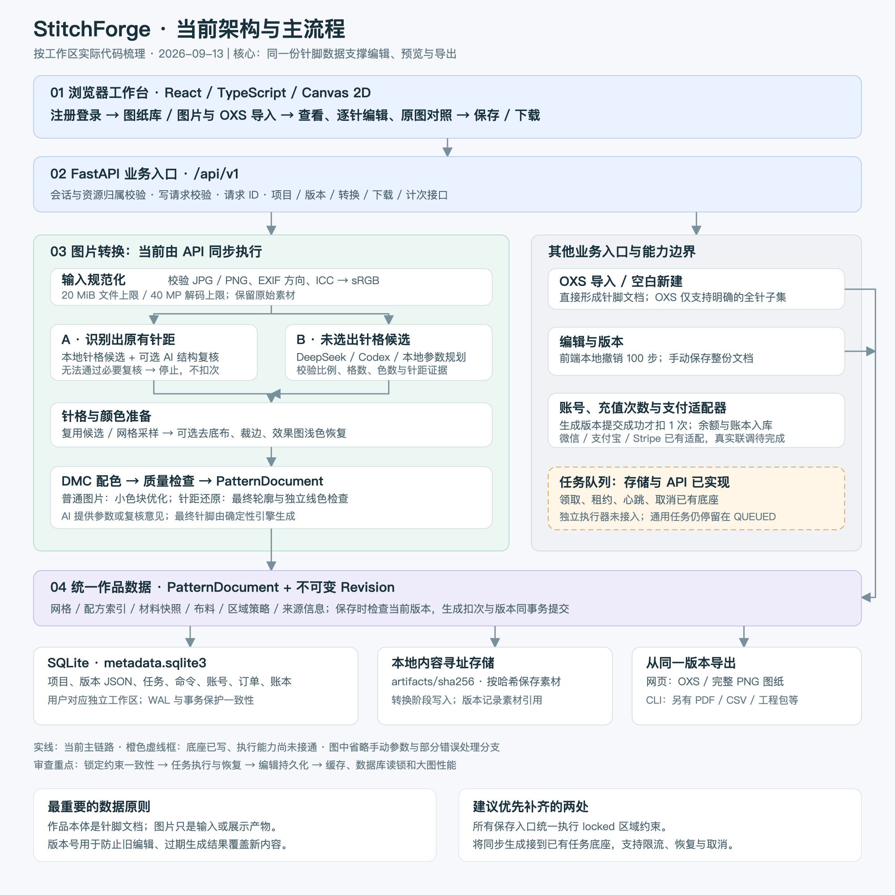

# StitchForge 当前架构与优化审查

审查日期：2026-09-13。以当前工作区代码为准，包含已有未提交修改。本次新增架构图和审查说明，未修改业务实现。

后续主要问题已按 TDD 实施，见[架构优化与验证记录](architecture-optimization-2026-09-13.md)。本页及附图保留优化前的审查快照，不代表最新运行流程。

## 1. 整体判断

项目是一个模块化单体：React 工作台调用 FastAPI，API 编排 Python 针脚引擎，SQLite 保存业务数据，本地内容寻址目录保存素材。CLI 可以直接调用引擎离线工作。

核心设计是 **PatternDocument 为作品本体**：图片转换、OXS 导入和人工编辑最终形成同一种针脚文档，再从指定版本生成预览、图纸和材料表。这条主线值得保留。

目前最需要补齐的是保存约束一致性、任务执行和编辑恢复。现有代码尚不能等同于设计文档中的完整异步工作台；暂时没有足够证据要求拆微服务、替换 SQLite 或改成 WebGL。

## 2. 当前架构图

[可缩放 SVG](architecture-overview.svg) · [可编辑 Mermaid 源文件](architecture-overview.mmd)

阅读顺序：浏览器 → API → 图片转换或直接导入/编辑 → 统一针脚版本 → 存储与导出。橙色虚线框表示已有任务基础设施，但尚未接入独立执行器。

图中图片链路展示自动导入的主流程；手动传入网格参数时会跳过自动针距候选和 AI 参数规划。素材由转换阶段写入文件系统，版本通过哈希引用素材。

## 3. 一次图片生成实际经过什么

1. 用户登录后上传图片。网页先创建独立项目及空白初始版本，再调用 `convert-image`。
2. API 检查账号归属、当前版本和剩余次数，检查文件并规范化 EXIF 方向、ICC 与 sRGB。
3. 自动模式先尝试识别已有针距。如果有候选，执行可用的 DeepSeek 结构复核；需要复核但服务不可用，或者复核拒绝，则停止生成。无需强制复核的候选可使用本地检查结果。
4. 没有选出针格候选时，按配置使用 DeepSeek、Codex CLI 或本地参数规划，并校验几何比例、格数和针距证据。AI 建议不是最终针格。
5. 复用针格候选或采样规范化图片，按分支去背景、裁掉空白边距、恢复效果图浅色。
6. 从实际材料目录进行受限配色，建立 `PatternDocument`。针距还原分支检查最终轮廓与独立线色；普通图片分支可优化小色块。
7. `add_revision` 再次检查当前工作头；在同一 SQLite 事务中扣 1 次、记录账本、授予素材访问权、保存版本并更新项目工作头。失败回滚，不会只扣次数而没有版本。
8. 网页显示图纸。编辑暂存在浏览器内存；手动保存或下载前保存时提交整份文档。网页下载支持 OXS、完整 PNG；CLI 的交付包另有 PDF、材料 CSV 和工程文件等。

入口：[App.tsx](../apps/web/src/App.tsx#L270)、[convert_image](../packages/api/src/stitchforge_api/app.py#L478)、[add_revision](../packages/storage/src/stitchforge_storage/sqlite.py#L573)。

## 4. 模块定位

| 模块 | 主要职责 | 关键代码 |
| --- | --- | --- |
| 浏览器工作台 | 登录、图纸库、导入、编辑、查看、下载 | `apps/web/src/App.tsx`、`components/` |
| 本地编辑与画布 | 笔画补丁、撤销/重做、可见区绘制、移动端手势 | `lib/editor.ts`、`components/PatternCanvas.tsx` |
| 业务 API | 项目/版本/任务路由、图片流程编排、导出 | `packages/api/src/stitchforge_api/app.py` |
| AI 辅助 | 参数规划、针格候选结构复核、结构化校验与降级 | `planning.py`、`structure_review.py` |
| 确定性引擎 | 规范化、针距候选、采样、分割、配色、优化、校验、导出 | `packages/engine/src/stitchforge/` |
| 存储 | 项目与不可变版本、任务租约、命令、内容寻址素材 | `packages/storage/src/stitchforge_storage/` |
| 账号与计次 | 会话、归属、订单、余额和账本 | API / Storage 各自的 `accounts.py` |
| 支付适配 | 微信、支付宝、Stripe 下单/查询/通知与结算 | `packages/api/src/stitchforge_api/payments/` |

引擎与 Web、数据库实现保持分离；当前瓶颈主要集中在 API 编排、资源控制和前端状态，而不是模块数量不足。

## 5. 按优先级排列的改进

### P1：统一保存入口的锁定约束——已复现正确性问题

**证据：** 命令接口通过 `apply_cell_updates` 检查 locked 区域，但网页保存走 `POST /revisions`，后者调用 `add_revision`，只校验新文档自身是否合法和工作头是否一致，没有比较旧版锁定格的语义。前端 reducer 也没有读取 locked 区域。

在临时数据库加载 `examples/minimal-pattern.json` 后，将第 0 格从配方 1 改为 2：

| 请求 | 实际结果 |
| --- | --- |
| `POST /commands` 修改同一锁定格 | HTTP 409，`LOCK_CONFLICT` |
| `POST /revisions` 提交包含该修改的整份文档 | HTTP 201，新版本第 0 格变成 2 |

**影响：** 一旦文档含锁定区域，使用整份保存可以绕过保护，导致应保留的眼睛、轮廓等被修改。这是作品约束问题，不是跨账号访问问题。

**建议：** 在统一提交服务中比较基础版本和新版本，校验锁定格的存在性、实际材料、股数、方向及几何变化；显式解锁通过独立操作表达。前端同时提示或阻止锁定格修改。不能只在前端禁用画笔。

**验收：** 所有普通保存、命令修改和其他替换内容的入口遵守同一规则；增加“配方索引未变但材料/股数变了”“删除锁定区域定义”“改变网格”这些绕过路径的回归。

位置：[前端保存](../apps/web/src/App.tsx#L370)、[前端 reducer](../apps/web/src/lib/editor.ts#L46)、[版本接口](../packages/api/src/stitchforge_api/app.py#L465)、[版本存储](../packages/storage/src/stitchforge_storage/sqlite.py#L573)、[命令保护](../packages/engine/src/stitchforge/commands.py#L35)。

### P1：接通独立计算任务，并补齐限流与结果恢复

**现状：** 图片规范化、AI 等待、配色与优化都在 `convert_image` 同步请求中执行。`jobs` 表及领取、心跳、租约、阶段结果、取消逻辑已有实现，但没有实际 worker 调用。PNG 导出有进程内信号量，图片转换没有对应的全局重型任务并发上限。

**影响：** 长请求会持续占用计算和请求处理资源；浏览器超时或断线不等于生成失败。不同项目可同时计算，可能在最后提交时才发现次数不足，浪费前面的计算。这里不意味着单个同步请求必然阻塞整个事件循环。

**建议：** 抽出可独立调用的转换服务，用现有 SQLite 队列驱动一个计算进程，API 返回 `job_id`，网页查询进度并可恢复结果。先限制全局并发和每用户在途任务数；支持取消、阶段超时、重启恢复。保持“版本 + 扣次”原子提交。

**请求去重边界：** 目前同项目、同旧工作头的重试会被 409 拒绝，不会重复扣次；但没有稳定生成请求 ID 返回先前结果。网页重新点导入会另建项目。应添加用户范围内的幂等键，绑定素材哈希、参数、输入版本；相同键且不同请求内容必须拒绝。不要用图片哈希永久阻止用户主动再次生成。

**上传边界：** 当前 `Body(bytes)` 在路由内才检查 20 MiB 限制；不是边接收边限量。公开运行前应在接收层限制实际字节数，并限制解码/计算并发。现有 40 MP 解码上限仍需保留。

**验收：** 断线后找到已完成结果；相同请求不重复计算/扣次；worker 被终止后任务可恢复；取消结果不会晚到覆盖工作头；大文件在接收阶段被拒绝。

位置：[转换入口](../packages/api/src/stitchforge_api/app.py#L478)、[任务入口](../packages/api/src/stitchforge_api/app.py#L821)、[任务领取](../packages/storage/src/stitchforge_storage/sqlite.py#L917)、[前端导入恢复边界](../apps/web/src/App.tsx#L339)。

### P2：让编辑可恢复，并打通现有命令能力

**现状：** 前端每笔保存补丁，撤销历史上限 100 步；草稿和历史仅在内存，localStorage 只保存最近项目 ID。有离页提示，但没有持久草稿。API 已支持命令 ID、基础版本、补丁、撤销/重做，网页尚未使用。

**建议：** 先增加按用户/项目隔离的本地草稿与待提交队列，记录基础版本；随后对笔画使用稳定命令 ID 提交。保存冲突应允许重新加载或另存草稿，保留本地修改。项目切换后的旧请求响应需要校验所属会话，避免更新另一项目的状态。

大面积填充还要处理命令接口的 5,000 格上限：不能简单拆请求就让一次用户操作变成难以原子撤销的几十次编辑，应显式设计批次和一次撤销的语义。

**验收：** 刷新、浏览器崩溃、断网重连、多标签页冲突后能恢复草稿；旧账号草稿不会在新账号中展示；保存进行中继续编辑仍正确显示未保存。

位置：[编辑状态](../apps/web/src/lib/editor.ts#L1)、[恢复项目](../apps/web/src/App.tsx#L154)、[保存](../apps/web/src/App.tsx#L353)、[命令接口](../packages/api/src/stitchforge_api/app.py#L837)。

### P2：先修缓存覆盖和只读请求的写锁，再评估数据库替换

**已复现：** 缩略图路由设置 `private, max-age=31536000, immutable`，全局中间件随后无条件改成 `no-store`。实际 GET 缩略图返回 200，但 `Cache-Control` 是 `no-store`。每次缩略图请求仍读取整份版本 JSON 并重新栅格化。

**另一个代码事实：** `authenticate`、`owns_asset`、`billing` 等只读查询也走 `_transaction()`；该方法执行 `BEGIN IMMEDIATE`。因此查看图纸和素材的请求也会竞争数据库写事务，而不只是读锁。实际延迟影响尚未压测。

**建议：** 账号、余额等敏感动态响应保留 `no-store`；图纸缩略图使用版本哈希驱动的服务端缓存，并按账号权限选择私有缓存或鉴权后条件请求。不要直接为所有素材开放公共长期缓存。将纯读查询改走只读连接或普通读事务，仅写操作使用 `BEGIN IMMEDIATE`。

**验收：** 同版本不重复生成缩略图，未授权请求不能命中可读取的缓存；并发查看与版本提交不会因为鉴权纯读而争抢写事务。

位置：[缩略图](../packages/api/src/stitchforge_api/app.py#L368)、[全局响应头](../packages/api/src/stitchforge_api/app.py#L1004)、[只读鉴权](../packages/storage/src/stitchforge_storage/accounts.py#L152)、[事务实现](../packages/storage/src/stitchforge_storage/sqlite.py#L151)。

### P2：针对 600 × 600 图纸优化编辑热路径

**代码事实：** 每次 paint 都复制完整 `cells` 数组；`isDirty` 最坏扫描全图，而且 App 每次渲染都会调用；针数统计在 cells 变化后全量重算。画布已有可见区裁剪和高 DPI 处理，这是可继续利用的基础。当前最大格数是 360,000，不能只按早期 90,000 格假设成本。

**建议：** 按帧合并指针更新，使用增量修改统计和脏格集合；从画布拆出悬停、工具栏等高频状态，减少全工作台重渲染；需要时引入分块缓冲。撤销回到已保存内容时，脏状态仍必须归零，不能只用“修改次数加一”替代内容判断。

**验收：** 对 300 × 300 和 600 × 600 场景记录拖画帧耗时、输入延迟、内存和大面积填充耗时，再决定是否需要外部 store、离屏绘制或 WebGL。本次未测 FPS，不能承诺具体提速倍数。

位置：[全量复制与脏检查](../apps/web/src/lib/editor.ts#L23)、[工作台统计](../apps/web/src/App.tsx#L56)、[画布绘制](../apps/web/src/components/PatternCanvas.tsx#L175)、[实际网格上限](../packages/engine/src/stitchforge/fabric.py#L7)。

### P2：建立可回放的转换记录和质量评测

**现状：** 已有来源哈希、材料快照、AI 规划记录，以及部分裁边/针距结构报告；规范化、背景、恢复、优化等报告在接口响应中返回，但不是所有阶段都统一保存成可关联的运行记录。同步转换先写文件，最后才提交数据库；失败或版本冲突可能留下没有提交引用的对象。

**建议：** 为每次转换保存 manifest：原始素材、规范图、对照裁图、输入参数、算法版本、材料目录哈希、模型/提示词版本、各阶段报告、耗时及最终版本。将已写的阶段产物接入任务记录；清理孤立素材时采用引用检查和保留期，排除运行中任务，并尊重回收站恢复语义。

质量评测在已有 fidelity 和 counted-stitches 测试上补充带人工确认针格的样本：照片针距、浅色主体、单针眼睛、细茎、独立线色、普通插画、满幅风景、文字。分别比较网格尺度、关键结构、线色保留、碎色、色差与人工修订量。AI 复核结果应作为一个信号，不充当唯一正确答案。

当前 DMC 数据包含屏幕近似色，实体线色和布料/股数效果仍需要实物校准；调整模型不能代替这部分验证。

**验收：** 从任一历史版本找到完整转换输入和报告；算法变更能与固定基线比较；失败后遗留对象可安全回收。

位置：[素材写入](../packages/api/src/stitchforge_api/app.py#L588)、[规划记录与报告](../packages/api/src/stitchforge_api/app.py#L728)、[响应报告](../packages/api/src/stitchforge_api/app.py#L807)、[内容寻址存储](../packages/storage/src/stitchforge_storage/artifacts.py)、[现有评测工具](../tools/run_fidelity_benchmark.py)。

### P3：收敛编排服务、契约和“当前状态”文档

**现状：** `app.py` 1,081 行，单个转换函数约 340 行；`App.tsx` 706 行，多种业务状态集中。前端 `PatternDocument` 是手写的部分类型，允许任意额外字段；服务端已有完整 Schema。规划和结构复核各自实现了一套 DeepSeek 请求、配置和错误处理。

**建议：** 按职责拆项目、转换、导出路由及转换应用服务；从 Schema 生成领域类型，从 OpenAPI 生成或校验传输契约；统一模型适配器和配置解析，保留不同任务自己的 schema 与失败策略。用显式数据库迁移管理后续表结构变更。

设计文档需要明确区分目标与实现：其中仍有“独立计算进程”“90,000 格”“初始保留背景”“提交命令持久化”等早期决策，当前代码分别是同步转换、最高 360,000 格、按自动策略去背景、本地编辑后整份保存。建议维护一张能力状态表，避免下一轮按旧假设继续开发。

位置：[API 编排](../packages/api/src/stitchforge_api/app.py)、[前端类型](../apps/web/src/lib/types.ts#L24)、[规划](../packages/api/src/stitchforge_api/planning.py)、[结构复核](../packages/api/src/stitchforge_api/structure_review.py)、[设计目标](design.md)。

## 6. 建议实施顺序

1. 修复所有保存入口的 locked 约束，补跨入口回归；修复缓存覆盖、只读事务与当前状态文档。
2. 抽出转换服务并接通现有任务队列，加入并发上限、幂等请求、结果恢复和任务进度；保留原子扣次。
3. 加入本地编辑恢复、明确冲突处理，再接通命令提交和服务端历史。
4. 用大图压测与人工确认样本指导渲染、算法和数据生命周期改进。

## 7. 本次验证

| 验证 | 结果 |
| --- | --- |
| `uv run pytest` | 280 passed，约 55 秒；2 条测试依赖弃用提示 |
| `pnpm test`（`apps/web`） | 5 个测试文件，24 项通过 |
| `pnpm build`（`apps/web`） | TypeScript 检查与生产构建成功 |
| 临时数据库跨入口锁定探针 | 命令 409，整份版本保存 201，确认绕过 |
| 临时数据库缩略图响应探针 | HTTP 200，实际 `Cache-Control: no-store`，确认覆盖 |
| 架构图 | SVG 渲染为 PNG 并检查布局 |

没有进行生产并发压测、浏览器交互回归、真实支付联调或新一轮 AI/实物质量评测。已有测试通过说明既有测试范围内的行为通过，不代表上述缺口已被覆盖或修复。
