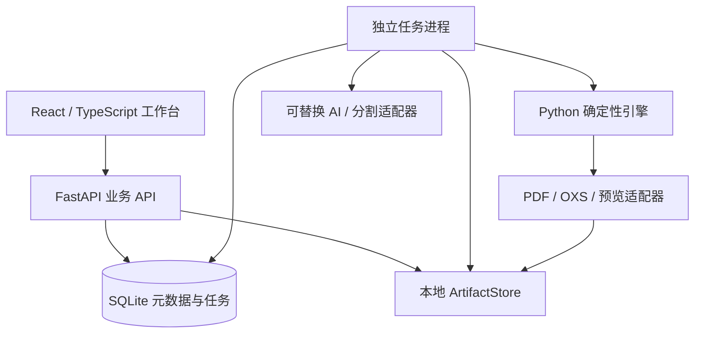

# StitchForge 产品与系统设计

- 版本：v1.2，2026-09-12。
- 状态：可进入 M0 实现的设计基线；不表示功能、软件兼容或试绣已经完成。
- 项目现状：已有引擎、API、SQLite 图纸库和 Canvas 工作台；现有本地数据需显式迁移到指定账号。
- 参考：[原始调研](references/ai_cross_stitch_engine_research_and_design.md)。原文保持不变；本文件收敛产品与架构决策，字段以[数据契约](data-contract.md)为准，交付以[研发与验收计划](implementation-plan.md)为准。
- 当前定位：自助账号制网站。OXS 导入和查看免费，图片成功生成按次数扣费，重视移动端查看。账号与计次的已实现范围及支付待接入项以[专项说明](accounts-and-billing.md)为准；下方引擎规划仍包含未实现目标。

### 当前实现校准（2026-09-13）

下文包含长期设计目标，当前运行能力以此表和[架构优化说明](architecture-optimization-2026-09-13.md)为准。

| 能力 | 当前实现 |
|---|---|
| 图片生成 | SQLite 持久队列、独立计算进程、阶段进度、取消、租约恢复；API 启动命令默认带起 worker |
| 任务范围 | worker 只执行 `image_conversion`；其他通用任务尚无执行器 |
| 编辑保存 | 网页整份版本提交，统一检查锁定和基础版本；未保存草稿及有容量上限的撤销栈存入 IndexedDB。逐笔服务器命令提交仍是后续目标 |
| 网格 | 单边最多 600 格、总计 360,000 格；下文 90,000 格性能假设属于早期基线，不能代表最大规模验收 |
| 背景 | 图片入口按分析后的背景策略处理；“初始保留背景”是早期方案 |
| 运行报告 | 输入、选项、色库及实现哈希、阶段报告和耗时存入不可变 JSON 产物，由版本引用 |
| 并发与恢复 | 单机最多 1 个图片计算，60 秒租约、5 秒心跳、600 秒任务超时；完成转换的检查点可复用，更细阶段检查点与外部 AI 计费结果追踪尚未实现 |

## 1. 产品目标与成功标准

用户上传图片、确定成品大小和工作量约束后，可以得到一份能逐针修改的设计。系统在可绣约束内优先保留原图结构和感知颜色，再减少不必要的碎色，最终导出清楚的黑白／彩色图纸、针脚预览、材料表和工程文件。

项目的共同原则是：**针脚数据是作品本体。每一项正式交付物都由同一不可变版本生成；AI 通过受约束的提案协助设计。**

第一版必须证明以下链路：

1. 手工定义的针脚可以准确生成图纸、图例和统计。
2. 不连接 AI 也能从图片生成、编辑并保存全针设计。
3. 用户能保护眼睛、文字等关键位置，对局部修改查看差异并撤销。
4. 重启、失败、重试和过期 AI 结果不会覆盖已经保存的设计。
5. 普通 PDF 可以打印阅读；目标软件兼容性具有独立记录。
6. AI 的价值由减少人工修订和改善可绣性证明，并与确定性基线比较。

“像刺绣的效果图”不能作为正式针脚预览。未来若提供生成式展示图，必须作为独立素材标明用途，不进入图纸一致性验收。

## 2. 第一版范围与默认值

### 2.1 产品分层

| 阶段 | 纳入 | 明确延后 |
|---|---|---|
| M0：交付链路 | 全针模型、材料结构、人工样例、校验、工程文件、预览、普通 PDF、基础 OXS 适配验证 | 图片自动转换、AI |
| M1：可用工作台 | 图片转换、手动裁切／掩膜、真实线色受限配色、三类候选、逐针编辑、锁定、撤销、版本和交付包 | 生成式重绘、多用户协作 |
| M2：AI 辅助 | 主体与关键区域建议、可选分割适配器、自然语言局部提案、差异确认 | 自动发布、直接让模型输出全图针格 |
| M3：质量闭环 | 打版师审核、代表区域试绣、材料估算校准、效果评测 | 全题材品质承诺 |
| M4：扩展 | 先勾边，再分数针／混线；独立推进矢量 PDF／扫描恢复 | 原生专有格式未经验证的导出 |

M1 是第一份可用产品；M2 完成后形成“AI 辅助版”。基础 OXS 导入以可识别的全针子集为范围。扫描图纸恢复和成品照片重建是两条后续能力，不合并成一个承诺无损的“逆向”按钮。

### 2.2 初始产品参数

下表是可调整的工程约束与交互默认值，不是行业标准或已测性能。所有生效值随版本保存。

| 项目 | 初始决策 |
|---|---|
| 用户端 | 桌面浏览器工作台；移动端先支持查看与下载，精细编辑延后 |
| 部署 | 本机 API、独立计算进程、SQLite 和本地文件存储；默认仅监听回环地址 |
| 图片 | JPG、PNG；单文件不超过 20 MiB，解码不超过 40 MP；动画、多页图片先拒绝 |
| 网格 | 每边 1–600 格；总数不超过 360,000 格；高还原候选要求最大连通主体有效宽度至少 160 格；按成品包围框、候选 CT 和工作量列出实际针格 |
| 颜色 | 单色全针；可用材料目录内 1–64 种配方，均衡默认上限 24；实际使用色数可更少 |
| 绣布 | 第一版结构支持 6–40 CT 方格 Aida；常用候选由实际布料目录提供，14 CT 只是初始显示值 |
| 股数 | 每个设计明确选择 1–6 股；目录中的两股只作回退，实体外观配置建立后按 CT、布色和覆盖率推荐 |
| 留边 | 每边默认 50 mm，可分别修改；展示裁布尺寸，发布前确认 |
| 输入色库 | 首批使用版本化 DMC Article 117 纯色身份；屏幕近似色与实体绣样测量分层保存 |
| 背景与抖动 | 初始保留背景；删除背景必须选定区域；抖动默认关闭 |
| AI | 可选配置；首次向外部模型发送素材时明确展示范围并取得用户选择 |
| 同时计算 | 默认一个重型任务；任务数量与阶段资源均有上限 |

尺寸设置提供两种互斥主输入：`grid` 或 `physical_fit`。前者由格数计算成品尺寸；后者把用户宽高视为最大包围框，先换算允许格数再保持比例向下取整。必须展示量化后的实际尺寸和与目标的差值。若一边不足一格或超过限制，返回约束错误，不能偷偷拉伸或降低要求。

绣制宽度为 `width_cells / CT × 25.4 mm`，高度同理。画布尺寸用于裁布，非空针脚包围框单独展示。改变 CT 不改变针格数量；裁切、旋转和重采样则是新的设计操作。

## 3. 用户流程与工作台

### 3.1 主流程


新建时只要求图片、目标尺寸或格数、颜色预算和可接受工作量。系统列出不同 CT 对应的实际针格和尺寸；布底色、股数和留边可以采用明确显示的建议值，交付预检集中确认。不要让初学者先填写整张材料表。

候选默认共享构图、网格和材料设置，通过颜色预算与碎色优化强度区分“简易／均衡／细节”。以用户预算 `K` 为上限，预算建议分别为 `min(K,12)`、`min(K,24)`、`K`；重复配置去重，允许只产生一至两个不同候选。增大网格作为单独建议，避免把不同尺寸的结果当成同等成本比较。

候选卡片显示实际尺寸、有效配方数、全针数、孤立针／小色块比例、关键区域差异和处理耗时。用户选择后形成工作版本；其余候选保留为可回看的分支结果。

### 3.2 编辑器布局

| 区域 | 内容 |
|---|---|
| 顶栏 | 项目名称、保存状态、撤销／重做、原图对照、交付 |
| 左侧 | 画笔、橡皮、取色、矩形／套索选区、填充、区域保护 |
| 中央 | 可平移缩放画布；原图、色块、针脚模拟、符号图切换 |
| 右侧 | 线号与股数、同色高亮、当前选区、问题列表、AI 提案 |
| 底部 | 全局格坐标、选中针配方、缩放比例、当前版本和任务状态 |

低倍率看色块与轮廓，中倍率看网格，高倍率显示符号与模拟交叉线；高倍率也允许手动隐藏纹理以便查图。中心定位使用网格边界几何位置 `(W/2,H/2)`，奇数网格中心可落在格子中间。

鼠标笔画先提供本地临时反馈，松开后合并为一次命令。后端确认前显示“保存中”；只有收到版本确认才显示“已保存”。切换工程或交付前必须完成待提交编辑。断线保留操作队列与基础版本，重连后检查冲突，不能直接覆盖服务端。

第一版提供键盘撤销／重做、方向键移动焦点、坐标跳转、数值选择配方以及可读取的材料列表。画布信息不能只靠颜色表达。

## 4. 架构与技术决策

### 4.1 模块化单体与独立计算进程



首期保留少量部署组件。元数据与任务表使用同一数据库，提交任务和记录输入版本在一个事务中完成，无须先引入 Redis、消息中间件或微服务。计算进程领取任务并产生不可变结果，API 不执行耗时转换。

账号版为每个用户分配独立工作区，并保护项目、版本、任务与素材。计费采用充值次数；扣次与生成版本事务提交。公开分享和多人协作暂未建设；真实商户联调、邮件验证与正式部署仍待完成。

| 层 | 选型与理由 | 引入条件或边界 |
|---|---|---|
| 领域引擎 | Python 独立包；数组操作、图像处理与导出可离线执行 | 不导入 Web 框架、数据库实现或 AI SDK |
| 图像／数值 | Pillow、NumPy；统一颜色转换采用 Colour | 依赖与数值运行环境在 M0 锁定，禁止各模块自写不同色差公式 |
| API | FastAPI；明确请求模型、错误码和版本前置条件 | 不同时引入 Django；重型任务不放进请求或 `BackgroundTasks` |
| 前端 | React、TypeScript、Vite；Canvas 2D 分层绘制 | 先测 90,000 格；Canvas 达不到目标再评估 WebGL |
| 状态 | 外部文档 store 保存快照和补丁，React 订阅选区／统计等状态 | React 快照不可原地变化；Canvas 缓冲区与文档快照分离 |
| PDF | ReportLab 绘制矢量网格及嵌入字体文字 | 符号字体与中文字体分开验证；选型不等同于 PK 兼容 |
| 元数据 | SQLite，短事务，单个计算 worker；通过 Repository 边界使用 | 多主机、多工作区并发需求成立时迁移 PostgreSQL |
| 产物 | 本地内容寻址文件，统一 ArtifactStore 接口 | 云部署再增加对象存储实现，不把绝对路径写进工程 |
| AI | 任务级 Provider 接口与结构化提案 | M1 不依赖；不锁定某个模型品牌 |
| 工具链 | Python 用 uv；前端用 pnpm；分别提交锁文件 | 搭建代码时选定运行时与精确版本，不在设计中宣称“最新” |

FastAPI 官方将重型后台计算与轻量响应后任务区分，本设计因此使用独立进程。[FastAPI 后台任务](https://fastapi.tiangolo.com/tutorial/background-tasks/)

React 的外部 store 接口要求稳定订阅和可缓存的不可变快照，适合将针格缓冲与控件渲染分离。[React useSyncExternalStore](https://react.dev/reference/react/useSyncExternalStore)

### 4.2 建议代码目录

```text
apps/
  api/                    路由、鉴权边界、业务应用服务
  worker/                 领取任务、心跳、阶段执行、取消
  web/                    React 工作台与 Canvas 渲染
packages/
  engine/src/stitchforge/
    core/                 模型、坐标、命令、语义校验
    imaging/              规范化、掩膜、网格采样
    palette/              材料候选、颜色转换、受限量化
    quality/              硬规则、碎色、差异与统计
    render/               同源针脚与图纸显示数据
    formats/              工程、PDF、OXS
  contracts/              从 Schema 生成的前端类型，禁止手动分叉
adapters/                 数据库、文件存储、模型供应商
schemas/                  版本化 JSON Schema
examples/                 小型人工数据与预期结果
tests/                    属性、回归、格式、流程与性能测试
docs/                     设计、来源、兼容与试绣证据
```

这是实现目录规划，不表示这些代码已经建立。核心依赖方向是 API／worker／适配器调用 engine，engine 不反向依赖它们。先在一个 engine 包内按模块分工，避免把每一层拆成独立发布包。

### 4.3 核心内部接口

```text
validate(document, capability_profile) -> ValidationReport
convert(image, config, catalog_snapshot, protection) -> CandidateSet
analyze(document, metric_profile) -> QualityReport
plan_edit(document, command) -> Patch + ImpactReport
apply_patch(document, patch, preconditions) -> NewDocument
render(document, view_profile) -> Artifact
export(document, export_profile) -> ArtifactSet + LossReport
import_pattern(asset, source_profile) -> ImportDraft + ImportReport
```

接口接受显式输入，不从“当前项目”或全局色库读取隐式状态。模型、规则、材料版本、算法参数和随机种子均随任务记录。纯数值操作在固定依赖环境内复现；跨架构浮点结果的位级相同不作保证。

## 5. 领域模型与数据原则

完整字段见[数据契约](data-contract.md)。本节固定容易产生跨模块错误的语义。

| 概念 | 决策 |
|---|---|
| 项目 Project | 保存来源、工作区和当前工作版本指针 |
| 版本 Revision | 不可变的 PatternDocument 快照、父版本和操作记录 |
| 发布 Release | 将某一版本、导出配置、报告和完整交付清单绑定；这里指生成交付包，不是公开上网 |
| 材料 Material | 品牌＋系列＋字符串线号；保存该版本的材料快照 |
| 配方 Recipe | 材料及各自股数；MVP 只允许一种材料，模型未来扩展混线 |
| 全针层 | 行优先整数索引数组；0 为明确留空，正数引用版本内配方索引 |
| 识别未知 | 只存在于 ImportDraft，使用独立 resolution 状态；不能混入可发布 PatternDocument |
| 图例 | 配方 ID 到符号 ID 的稳定映射；具体字体和字符映射属于导出配置 |
| 保护区域 | `preserve` 为优化偏好；`locked` 为任何编辑必须遵守的硬约束 |
| 测试材料 | 明确标记 synthetic，只用于引擎与版式验证，不冒充 DMC 色值 |

锁定不只比较索引数组：必须比较针脚是否存在、材料身份、股数、上层对角方向。被引用配方和材料采用不可变身份；修改股数或线号创建新配方／材料版本，再替换允许修改的格子。改变全局 CT、画布尺寸或重采样会影响锁定语义，必须先显式解锁受影响区域。

删除未使用配方可以保留索引空洞，不自动重排剩余索引。图片自动配色预算为 1–64；已有图纸导入、编辑和保存最多支持 4096 个配方，不以生成预算强行合并原图线色。XSD 另受格式本身 240 个调色板项限制。前 64 个符号保持原映射，后续使用唯一的两字符 ASCII 标记，网页与 PNG / PDF 保持一致。候选应展示增加颜色后的误差收益，收益仍明显而触及生成上限时报告限制。更换导出样式时可以重新分配符号，但必须写入新发布配置。

## 6. 图片到针脚的确定性流水线

### 6.1 阶段与产物

| 阶段 | 处理 | 保存产物 |
|---|---|---|
| P0 输入规范化 | 验证实际格式、尺寸／帧数、EXIF 方向、ICC 配置 | 原文件、已定向的 sRGB 工作图、处理报告 |
| P1 构图 | 裁切、保留比例、手动掩膜；可选边缘连通底色建议或 AI 区域建议 | 变换矩阵、掩膜与用户选择 |
| P2 网格采样 | 按格计算覆盖率、颜色与区域权重 | 覆盖数组、目标颜色数组、网格区域掩膜 |
| P2b 效果图恢复 | 仅对明确标记的刺绣效果图抑制线缝阴影造成的浅色偏暗 | 恢复后的目标色与参数报告 |
| P3 配色 | 材料候选筛选、固定色约束、颜色预算内分配 | 材料／配方集合、初始针格 |
| P4 可绣性优化 | 连通域、局部替色、保护约束和差异控制 | 优化版本、修改补丁、质量报告 |
| P5 人工编辑 | 用户选择候选并逐针或按区调整 | 新 Revision、命令和逆补丁 |
| P6 交付 | 校验、图例、统计、分页、导出 | Release 与文件清单 |

原始文件始终保留到项目删除。AI 重绘若后续开启，成为新的源图分支，必须能够与原图并排比较；不能覆盖原图或绕过 P2–P6。

高还原工作流区分三个资产角色：`delivery_source` 是用户提供或最终展示的效果原图，`conversion_source` 是去除布纹、线缝、高光和压缩噪声后供采样的平面转换源，`frozen_master` 是已经确认的 DMC 针格。若先有针格母版，实体质感图和 Saga 图纸必须从同一母版派生；不得把实体效果图再次反向识别后声称两者同源。若只有照片或效果图，系统可以生成转换源候选，但必须保留原图、标明这是有损推断，并允许并排审核。

P2 后计算最大四连通针格主体的包围框。高还原候选默认要求主体有效宽度至少 160 格；小装饰、文字和孤立元素不应虚增该数值。低于门槛时给出扩大网格或裁切留白的建议，颜色数量不能替代空间分辨率。参考工程中 220×330 画布的主体有效宽度为 201 格，这一数值作为首批角色插画基准，不作为所有题材的固定规格。

### 6.2 颜色与透明度

先按图片的可用 ICC 信息转到工作 sRGB。缺少 ICC 时按 sRGB 解释并记录假设；无法解析的配置不能声称已准确校色。

透明区域不自动补白线。网格采样使用预乘 alpha：只对有效像素累计颜色，计算覆盖率；默认覆盖阈值 0.5，低于阈值留空，阈值固定进参数。已标记的关键细线或掩膜边缘若被该阈值消失，显示问题区域并允许用户逐针补回。白底不等于透明底。用户可以显式启用边缘连通底色建议：系统取网格边缘中位色，只留空从外边缘可达且在保守色差阈值内的格子，并保存估计色、阈值和删除数量。该结果必须可预览和撤销；浅色主体或复杂背景使用人工蒙版。

输入若是已经渲染过的刺绣效果图，模拟线缝、光照和高光不能直接视为材料颜色。`rendered_stitch` 配置只对亮、低色度的目标色有限提高 Lab 明度，保持饱和装饰色和深色轮廓不变，并保存实际调整的颜色数、针格数和最大调整量。普通图片使用 `artwork` 配置，不自动应用这项补偿。

颜色平均在统一的线性 RGB 中进行，之后转换到统一白点的 Lab；整条链固定白点、观察者与数值范围。首版匹配管线采用 sRGB／D65／2°，Lab 采用 `L* 0–100` 范围。实际测量数据若采用其他白点，必须通过显式转换适配器，不能直接混入同一距离计算。Colour 的 CIEDE2000 是实现参考，输入范围与转换以锁定版本文档及测试为准。[Colour CIEDE2000](https://colour.readthedocs.io/en/latest/generated/colour.difference.delta_E_CIE2000.html)

没有可信测量条件时，使用有来源的屏幕近似色，并在界面与报告标记。材料身份已知但色值未知的线，可以手动分配和统计，不能参加自动色差匹配；正式可视预览需用户补入近似显示色并标明来源。DMC 线号是材料身份，颜色名称只作显示文本；不得按名称合并或替换线号。

### 6.3 有限真实线色的配色

配色必须以最终有效材料数统计，多个源色组映射到同一 DMC 时只能算一种材料。首版保留两种可复现策略：直接材料贪心用于追求全局平均色差；Lab 聚类后映射材料用于先合并渲染噪声并保护小面积差异色。两种结果都按最终 DMC 针格重新计算完整误差，不能把聚类中心数量冒充实际颜色数。

步骤如下：

1. 过滤不属于所选系列、不可用或缺少匹配色值的材料，固定目录快照。
2. 收集锁定区域已经使用的配方作为必选集合；如果已超过预算，返回 `PALETTE_CONSTRAINT_CONFLICT`。
3. 直接材料策略基于网格颜色及区域权重建立最多 512 个代表颜色桶；从材料库筛出最多 128 个候选，必须包含必选色。
4. 聚类策略使用完整目标色分布做确定性 Lab 聚类，以远距初始化保留眼睛、花心和小道具等差异色；每个色组再用 CIEDE2000 映射到可用材料并合并重复线号。
5. 直接材料策略在候选中贪心选择能减少加权色差的实际材料，直到预算或收益阈值。两种策略的并列决策都按稳定颜色值或材料 ID 排序。
6. 将每一非空格分配到选定配方；锁定格不参与重分配，受保护格提高视觉损失权重。
7. 用完整目标网格计算实际质量报告，不能只用颜色桶或聚类中心的训练误差展示结果。

颜色桶划分、候选数、交换次数和退出阈值均属算法版本参数。候选筛选失败时可以回退到更大的材料集合，仍受资源限制；不得以随机替色掩盖失败。

### 6.4 空间优化及目标函数

设计目标采用可解释的几个分量，不展示为一个“AI 总分”：

```text
E = Σ_i w_i · ΔE00(target_i, thread[label_i])
  + λ · Σ_(i,j ∈ 4邻域) edge_weight(i,j) · [label_i ≠ label_j]
  + μ · small_component_penalty

硬约束：颜色预算、材料集合、留空策略、锁定格及其配方语义。
```

强轮廓处 `edge_weight` 较小，避免把本来应有的边界抹掉。`preserve` 区域提高视觉误差权重，并可设局部差异上限；`locked` 区域完全排除修改。小连通域只是待检查对象，眼睛高光不能因一针独立就被自动删掉。

首版采用可重复的局部搜索：按行优先扫描小连通域，尝试替换为相邻已选配方，最多五轮；每个建议在完整受影响区域重算能量及硬约束，仅在严格改善且符合局部误差预算时接受。相同收益按配方 ID 排序；保存所有接受的差异。不承诺全局最优，也不计算虚构的最优走线路径。

实际优化可以选不同 λ／μ 形成候选；参数值通过回归集校准，未校准前不称“新手难度认证”。默认不加抖动；全局色板发生变化时必须重新检查全图指标和锁定内容。

### 6.5 材料外观、CT 与股数

针格颜色最终由绣线、底布、CT、股数、针脚覆盖和观察条件共同形成。当前 `display_srgb` 只用于数字近似匹配；股数已经进入配方，但尚未参与颜色预测。界面必须显示这一限制，不能把改变股数后的预览称为实物准确模拟。

M3 建立版本化 `AppearanceProfile`：绑定材料身份、绣布身份／底色／CT、股数、针法、测量光源与观察者、Lab 或光谱数据、覆盖率及不确定度。届时候选评分使用绣好针格的实测外观。没有相应配置时回退到材料近似色，并降低可信度。

固定针格时改变 CT 只改变物理尺寸；固定物理尺寸时提高 CT 才能增加针格和空间细节。规划器必须成组展示 `CT + 网格 + 实际尺寸 + 针数上限`，避免把高 CT 本身误报为更高还原度。

### 6.6 局部重算边界

首次实现以全图确定性重算为正确性基线。局部图像处理可以按选区及一圈邻域计算，但连接域可能延伸到整个画布，碎色统计须对受影响配方的完整连接关系重建，90,000 格时可以直接全量重算。

局部模式默认冻结当前配方集合；如需新增配方且预算不足，返回全局配色建议，不能悄悄挤掉锁定主体的颜色。只改绣布 CT 不重做图片配色，但会重新计算物理尺寸、材料估算和所有导出。

## 7. 质量、材料与预览

### 7.1 指标精确定义

| 指标 | 口径 |
|---|---|
| `full_stitch_count` | 全针数组中非 0 的格数；留空和分页重叠不计 |
| `used_recipe_count` | 被非空针脚实际引用的不同配方数 |
| `material_count` | 使用配方中不同材料身份数；未来混线时与配方数分开 |
| `isolated_stitches_4` | 同配方 4 邻域连通域大小等于 1 的针数 |
| `small_component_ratio_4` | 大小不超过 3 的同配方连通域中针数／全部非空针数 |
| `low_usage_recipes` | 使用针数小于 5 的配方清单；只警告，不自动删除 |
| `local_recipe_p95` | 从左上原点划分不重叠 10×10 窗口，非空窗口色数的最近秩 P95；边缘截断窗口计入 |
| `weighted_delta_e` | 非空目标格的加权平均色差，同时报告关键区域及全局 P95 |
| `protected_changed_cells` | 相对提案基础版本发生针脚语义变化的保护格数，锁定区域必须为 0 |
| `blank_coverage` | 留空数／画布格数，透明删除前后差异另报，避免靠删除困难区域降低色差 |

分母为 0 的比率和无样本色差返回 `null` 并说明原因。全空草稿允许保存，正式交付预检默认阻止，避免误交付空图。指标版本、阈值、邻域规则写入报告。

### 7.2 用线统计与估算

M1 必须准确给出线号、股数、针数及占比。采购用量是可选估算：未具备实绣系数时显示“尚未校准”，不能把正面两条对角线长度直接当实际耗线量。

估算器预留显式模型：`single_strand_meters = Σ(N_r × per_stitch_path_m_r × component_strands) + 起收针及跨区单股米数`。其中路径系数依赖 CT、走线方式和标定数据，记录低／中／高估计值及模型版本。按材料聚合所有配方后，再除以包装的 `length_m × strand_count` 并向上取整；采购余量只能应用一次，包装规格必须来自实际目录，缺失时不输出“绞数”。

未校准工时同样允许为空；后续用使用者速度和试绣反馈提供区间。连通域数是操作负担参考，不能直接视为准确换线次数。

### 7.3 渲染一致性

编辑器与导出器共享针格、配方与符号语义，但各自实现绘制。验收比较语义与可见元素，不要求 Canvas 和 PDF 像素完全相同。

正式针脚模拟按一个非空格绘制两条规定方向的交叉线，留空露出布底色；所有纹理只能调节已有针脚的表现，不能添加毛发或高光针。预览显示“线色为近似显示”，实体效果通过试绣评价。

## 8. 编辑命令与 AI 提案

### 8.1 通用命令

| 命令 | 参数与行为 |
|---|---|
| `paint_cells` | 一次笔画的坐标和目标配方；0 表示清除；重复坐标先归并 |
| `fill_region` | 冻结的网格掩膜和目标配方，不使用执行时变化的选区 |
| `replace_recipe` | 在明确范围将 A 替换为 B，不修改 A 的定义 |
| `merge_recipes` | 把多个配方替换成某个已有或新建配方，预览全图影响 |
| `set_region_policy` | `editable/preserve/locked`；解锁只能由用户明确操作 |
| `simplify_region` | 区域、预算与固定配方集合，生成候选补丁，不能直接覆盖 |
| `set_fabric` | CT、底色、留边变更；预检对锁定／尺寸／预览的影响 |
| `restore_revision` | 将旧版本内容作为新版本提交；不移动或删除历史记录 |

`paint_cells` 每批最多 5,000 个格；更大的选区操作通过压缩掩膜或异步提案。裁切／重采样是全局操作，不混入普通画笔命令。MVP 不提供随意更新任意 JSON 路径的写接口。

每条命令含 `command_id`、`base_revision_id`、`type`、`payload`。服务端校验基础版本、坐标、材料、资源上限及锁定语义，原子提交“新版本＋命令记录＋逆补丁＋当前指针”。整个笔画要么成功，要么失败，不局部跳过锁定格后假装完整成功。

撤销／重做也生成新版本；若当前头部已发生其他编辑，要求重新预览逆补丁，不能跳过并发检查。第一版采用乐观并发和线性工作头，不引入 CRDT 或多人实时协作。

### 8.2 AI 输入输出边界

AI 只能接收所需的原图缩略图、针脚预览、区域、约束和质量摘要；全图针数、配方统计和导出结果由程序计算。供应商适配器负责尺寸限制、超时、计费统计和脱敏日志。

```json
{
  "base_revision_id": "rev_17",
  "intent": "减少天空碎色，保留猫眼",
  "operations": [
    {"type": "simplify_region", "region_id": "sky", "palette_mode": "fixed", "strength": "medium"}
  ],
  "protected_region_ids": ["eyes"],
  "reason": "天空的小连通域较多，可尝试邻色合并"
}
```

这个对象只是模型建议。服务端解析允许的操作枚举、检查区域与数值，生成独立候选和真实 `ImpactReport`。影响针数、删减色数、锁定区域差异必须由程序填写，不能采用模型猜测。

用户接受时引用 `proposal_id + proposal_hash + base_revision_id`；编辑发生后，旧提案返回过期冲突。需要“重新应用”时重算并再次展示差异，不能只更改版本号。AI 无权解锁、删除项目、选择文件路径、调用任意代码或发布作品。

模型失败时保留确定性候选；语义分析、分割、局部修改分阶段降级。M2 至少能在不安装 GPU 分割模型的环境下手工画掩膜并继续完成任务。是否引入 SAM 系列取决于项目素材上的收益、资源和授权评估，而不是第一版前置依赖。

## 9. API 与错误语义

API 前缀 `/api/v1`。以下是目标接口契约；项目／版本／命令／任务基础接口和自用图片转换桥接已经运行。所有项目资源先检查所属工作区；本机版也使用同一资源边界，后续加入账号时不改业务主键。

| 方法与路径 | 请求关键字段 | 返回与约束 |
|---|---|---|
| `POST /projects` | 名称、初始配置 | 201，项目与初始空草稿版本 |
| `GET /projects/{id}` | — | 当前工作头、来源、最近任务及交付版本 |
| `POST /projects/{id}/assets` | multipart 文件、用途 | 201，asset_id；校验真实类型与解码资源 |
| `POST /projects/{id}/conversions` | asset_id、基础版本、构图、材料／算法配置 | 202，job_id；产出候选，不自动替换工作头 |
| `POST /projects/{id}/convert-image` | 原始 JPG／PNG 请求体、基础版本、网格／材料配置 | 当前自用桥接：201，新版本、素材引用及转换报告；后续迁移到 assets＋conversions |
| `GET /assets/{sha256}` | 内容哈希 | 按账号素材授权读取，私有响应 no-store |
| `POST /projects/{id}/imports` | asset_id、源格式 profile | 202，ImportDraft 与报告由任务查询 |
| `POST /projects/{id}/imports/{draft}/resolve` | 待确认项 ID、明确值或放弃项及原因 | 200，新草稿；确认完整后才可转为版本 |
| `POST /projects/{id}/imports/{draft}/accept` | base_revision_id、已解决草稿哈希、损失确认 | 201，受支持的新版本；再次检查全部未知项与损失 |
| `POST /projects/{id}/candidates/{candidate}/accept` | base_revision_id | 201，新工作版本；过期返回 409 |
| `GET /projects/{id}/revisions/{rev}` | — | PatternDocument、ETag／内容哈希 |
| `POST /projects/{id}/commands` | command_id、base_revision_id、命令 | 201，新版本和影响；前置版本不可省略 |
| `POST /projects/{id}/proposals` | base_revision_id、自然语言、区域 | 202，生成提案任务 |
| `POST /projects/{id}/proposals/{proposal}/accept` | 提案哈希、base_revision_id | 201，新版本；再次检查锁定及前置版本 |
| `GET /jobs/{id}` | — | 阶段、进度、心跳、结果引用、错误 |
| `POST /jobs/{id}/cancel` | — | 202，取消请求；阶段结束才到终态 |
| `POST /projects/{id}/release-preflights` | revision_id、导出配置 | 202，完整校验与损失预检报告 |
| `POST /projects/{id}/releases` | revision_id、preflight_hash、配置哈希、已确认损失项 | 202，固定版本生成交付包 |
| `GET /projects/{id}/releases/{release}` | — | PREPARING／READY／FAILED、清单及下载入口 |
| `GET /artifacts/{id}/download` | — | 经项目授权解析存储引用，不接受任意本地路径 |
| `DELETE /projects/{id}` | 明确项目 ID | 202，先封禁写入并取消任务，再按删除流程清理 |

写请求使用 `Idempotency-Key`，作用域为工作区＋路由＋键；相同键相同内容返回原结果，相同键不同内容返回 409。命令 ID 与发布请求 ID 有唯一约束。创建成功但客户端超时后，重试不能重复绘制或生成重复发布记录。

所有请求错误用统一结构：`{code,message,details,retryable,request_id}`。长任务失败则在任务资源返回同样的错误对象，不把任务处理失败伪装成 HTTP 请求成功后的空结果。

| HTTP／错误码 | 语义 |
|---|---|
| 409 `REVISION_CONFLICT` / `PROPOSAL_STALE` | 返回当前版本；用户重新查看差异 |
| 409 `LOCK_CONFLICT` / `PALETTE_CONSTRAINT_CONFLICT` | 返回问题格、区域或所需最低预算 |
| 413 `RESOURCE_LIMIT` | 文件大小、解码像素或请求规模超限 |
| 415 `UNSUPPORTED_FORMAT` | 不支持的真实文件类型 |
| 422 `INVALID_DOCUMENT` / `UNRESOLVED_IMPORT` | 数据或语义约束不成立，包含字段路径 |
| 422 `EXPORT_LOSS_UNCONFIRMED` | 必须先查看损失预检，不静默降级 |
| 503 `MODEL_UNAVAILABLE` | 可回退手工／确定性处理；已有版本仍可使用 |

普通轮询采用约一秒的活动任务间隔，空闲时退避。首期不要求 WebSocket；进度只在可测阶段内报告比例，外部模型等待显示阶段与耗时，不能伪造平滑百分比。

## 10. 任务、版本、缓存与持久化

### 10.1 状态分离

```text
Job: QUEUED → RUNNING → SUCCEEDED / FAILED
                    → CANCEL_REQUESTED → CANCELLED
      QUEUED → CANCELLED

ImportDraft: NEEDS_REVIEW → RESOLVED / DISCARDED
Proposal: PENDING → ACCEPTED / REJECTED / STALE
Release: PREPARING → READY / FAILED
```

Revision 的内容不可变，不把它标成“计算中”。转换与 AI 结果是候选，只有用户接受才更新项目头。失败只改变任务状态，不破坏最近有效版本。

`validation`、`software_compatibility`、`designer_review`、`stitch_test` 是分别有证据引用的记录。后续补做试绣可以增加一条证据记录，不能改写已经交付的清单；需要更新包内说明时生成新 Release。

### 10.2 任务持久性

任务表记录输入版本、类型、阶段、参数哈希、尝试次数、`lease_owner`、`lease_epoch`、心跳与截止时间。默认租约 60 秒、每 10 秒心跳；参数可调。领取和完成都是带租约代数的条件更新，过期 worker 的迟到结果不能提交。

每个阶段输出写到临时文件，关闭并校验后原子重命名为内容哈希路径，再在数据库短事务登记产物和阶段完成。文件写好但数据库未提交时仅产生可回收孤儿，不允许数据库指向尚未写完的文件。

worker 重启后检查过期 RUNNING 任务：可重入阶段从已完成产物恢复，最多两次自动重试；参数／数据错误不重试。外部 AI 请求若超时后计费状态未知，记录 `external_outcome_unknown`，不自动重复收费调用，用户可显式重试。

任务取消在阶段检查点响应；不可中断库调用运行于子进程，超时或取消后可终止该进程。提交时再次检查取消状态及租约，取消任务不得把迟到输出发布为结果。临时文件后续清理。

### 10.3 缓存与复现

```text
stage_key = SHA256(canonical_json({
  stage, input_artifact_hashes, parameters,
  schema_version, engine_version, rule_version, catalog_version,
  colour_version, renderer_version, seed,
  saved_model_output_hash, protection_hash
}))
```

阶段仅纳入实际依赖的字段，防止 CT 变化导致无关语义分析重做。修改色库、掩膜、种子或锁定区域必须让相关缓存失效。缓存命中不绕过权限检查；首期只在本工作区复用。

AI 保存供应商、模型标识、模板版本、输入摘要、原始结构化输出、解析结果和费用；提示词与 seed 不能保证外部模型重新运行相同。支持的是重放已保存提案及确定性操作，不承诺再次请求云模型得到相同文本。

### 10.4 元数据表

| 表 | 关键字段／约束 |
|---|---|
| `workspaces` / `projects` | workspace_id、project_id、head_revision_id、删除状态 |
| `assets` | 来源文件哈希、实际媒体类型、尺寸、所属项目、存储引用 |
| `revisions` | revision_id、project_id、parent_id、document_hash、快照引用、schema_version |
| `commands` | command_id 唯一、基础／结果版本、正逆补丁、操作者 |
| `jobs` / `job_stages` | 状态、租约、输入哈希、阶段结果、重试与成本 |
| `import_drafts` / `proposals` | 基础版本、问题／提案产物、状态和确认记录 |
| `artifacts` | 哈希、长度、类型、storage_key、所属工作区 |
| `releases` / `release_artifacts` | revision_id、配置哈希、清单引用、READY 门禁 |
| `validation_evidence` | 版本／发布、验证类型、范围、环境、结果、附件 |
| `idempotency_records` | 工作区＋路径＋请求键唯一，request_hash、响应引用 |

MVP 每次已提交命令存一份压缩完整快照和补丁，90,000 格时优先简单可靠。若历史体积实际成为问题，再改为关键帧＋增量，不让首期依赖完整事件溯源才能打开文件。

备份以一致数据库备份和其引用的全部不可变产物构成，附哈希清单；恢复演练必须能够打开一个历史版本及交付包。引用清理采用标记再删除，给正在运行的任务和未完成发布留出保护期，不能仅按文件修改时间删除。

## 11. 工程文件、PDF、OXS 与交付

### 11.1 自有工程与正式交付包

自有工程扩展名暂定 `.stitchforge`，内部 ZIP 包含 `manifest.json`、`pattern.json` 和按需包含的来源／掩膜／报告。单独的 `pattern.json` 必须已含完整针脚、所需材料与配方快照，能够离线查看编辑；源图可不带，但因此缺少重新转换能力应明确显示。工程不包含 API 密钥、数据库连接或其他项目路径。

工程容器版本与 PatternDocument 版本分开演进。读取未知核心版本时拒绝编辑；可显示包内预览并保留原文件。完整哈希、路径和迁移规则见数据契约。

正式交付包至少包含：

```text
manifest.json
pattern.stitchforge
preview.png
chart-color.pdf
chart-bw.pdf
materials.csv
validation-report.json
```

OXS 和目标应用 PDF 是所选配置的附加项。预检列出要生成的所有文件；全部必选文件生成并校验后才将 Release 标为 READY。某一出口失败，不用旧版本文件补齐。正式默认包不附原始照片，带原图工程是明确选择。

清单含项目／版本、文档哈希、各文件 SHA-256 与字节数、引擎和配置版本、生成时间、确认的损失、验证证据。清单本身不包含自身哈希；其哈希由 Release 元数据或外部下载校验提供，避免自引用。不同导出配置有不同 Release，设计数据不被打印选项改变。

### 11.2 普通 PDF 的可执行排版规则

默认 A4 竖版，四周 12 mm，图纸区域预留顶部 18 mm、底部 12 mm。可绘网格区域为 186×243 mm。默认单格 3 mm，因此每页最多 62×81 格；这是阅读格大小，与成品在绣布上的尺寸无关。

分页规则采用半开区间。容量 `C`，相邻页重复区 `O=2` 格，步长 `S=C-O`；总格数 `N` 的页数为 `max(1, ceil((N-O)/(C-O)))`。第 i 页范围 `[i*S, min(i*S+C,N))`。横向再纵向枚举，行优先编号。页数必须先按两个方向算出再相乘。

例如 160×240 格：横向页区间 `[0,62)`、`[60,122)`、`[120,160)`，纵向 `[0,81)`、`[79,160)`、`[158,239)`、`[237,240)`，共 12 张图纸页，另加预览／图例页。最后一排虽只有 3 行也保留此规则；后续可以提供不同单格尺寸或分页优化配置，但必须重新生成页映射。这个例子用于检验覆盖和重复计数。

重复区加明确标识并在拼接地图显示，不能覆盖符号使其难认。内部索引从 0 起，面向用户的格编号从 1 起；页眉标出起止格编号，10×10 粗线按全局网格边界整十位置绘制，不按每页重新起算。

符号必须具有一对一配方映射；不只靠旋转、微小实心空心差异区分。M0 建立至少 64 个经打印检查的符号候选，实际可用数量不足时阻止超额导出并给出预算建议。字体文件记录许可、版本与哈希，符号字体与中文图例分别嵌入，检查缺字和替代字体。ReportLab 提供 TrueType 字体与 Unicode 文本支持；字体能力需在选定文件上实测。[ReportLab 字体文档](https://docs.reportlab.com/reportlab/userguide/ch3_fonts/)

预览页不与正式图纸共用可混淆的网格。图例按真实使用配方生成，含符号、品牌、系列、字符串线号、股数和针数；黑白版本离开彩色也能阅读。导出前独立比较图纸显示元素计数和针格统计。

### 11.3 Pattern Keeper 与 OXS

Pattern Keeper 官方的 WinStitch／MacStitch 指引要求可选择的 TTF 符号，建议 A4 或 Letter 竖版，并提示带网格预览可能被误认成图纸；该页面还说明勾边和特殊针法不在其支持范围内。因此建立独立 `pattern_keeper_pdf` 配置，其网格、符号、图例标题和页映射必须实机验证；未验证前显示实验性，不套用普通 PDF 的兼容标签。[Pattern Keeper 官方指引](https://patternkeeper.app/help/exporting-charts-from-winstitch-macstitch/)

OXS 采用来源软件与版本的 profile。公开说明给出布色索引、调色板和全针记录，也记载半针在不同年份的位置变化；因此不能仅凭后缀选择统一解析假设。首期只转换确认的全针、材料与尺寸；坐标基准、股数和符号映射由独立样例固定，未明确时先阻断。保留原文件以及未知对象报告，不把未知对象悄悄丢弃，也不把 `.oxs` 改名成 `.saga`。[OXS 公开说明](https://ursasoftware.com/OXSFormat/)

兼容 profile 至少记录应用名称／版本、操作系统、源格式／导出配置、功能集合、样例哈希、验证日期和差异。自己的导入器读回导出器只是回归检查，不能替代 Saga／其他目标软件的外部核对。

### 11.4 损失处理

每一项损失含 `code`、对象 ID、源语义、目标能力、用户影响、可否确认及建议。分成设计语义损失（线号、针法、股数、几何）、显示差异（符号外观）和工程元数据不支持（锁定、操作历史），必须分别报告。

MVP 对针脚／材料语义损失默认阻断该出口；后续若支持降级，先创建转换派生版本并重算其预览与统计，再导出，不能出现原设计预览配降级针脚。用户可确认 OXS 不保存编辑历史等非针脚损失；该确认绑定文档哈希、目标配置哈希和损失报告哈希。

数据越界、无效配方、未解决识别未知或锁定违规不可通过“我接受风险”绕过。可保存草稿／原文件供修复，但不能把错误标成正式发布成功。

## 12. 逆向与后续针法

OXS 导入先产生 ImportDraft，包含可解释内容与未知项；完成所有选择后生成受支持的 PatternDocument。识别置信度高也不是自动确认许可；未知线号、重复坐标冲突和尺寸不明均应定位到原始证据。

后续 PDF／扫描恢复按“文字矢量优先、图像识别补充”实施：定位网格、恢复页面坐标、符号聚类、关联该图专属图例、按全局坐标拼接、重叠冲突确认。每格状态是 `unresolved / accepted_empty / accepted_recipe`，并保存页码、局部坐标、候选及人工选择。验收同时看格准确率、整图完全正确率、关键区域错误和人工确认量。

成品参考重建进入图片打版管线，明确标记推定的尺寸／配色。没有原始结构数据时不能声称恢复唯一原图纸。

针法扩展顺序固定为勾边→分数针→混线／装饰。子网格整数坐标只解决几何表示，还需定义落针可行性、覆盖顺序、针法独立统计、符号、导出能力和试绣。高级图层不能先进入工程再依赖“不显示”掩盖缺少渲染器；通过新 schema 和 capability profile 整体开放。

## 13. 资源、隐私与运行边界

首版本机运行，拒绝未允许的 Origin／Host，状态修改需要会话令牌；不能因为绑定本机就允许任意网页操作文件。公开部署之前必须实现身份认证、工作区隔离、配额、TLS 和恢复演练，这属于部署范围变化，不能只将监听地址改为公网。

图片按实际解码尺寸限额，OXS 禁用 DTD／外部实体及网络引用，ZIP 拒绝绝对路径、`..`、符号链接和重复文件名，并限制解压后总字节数与文件数量。导入在受限子进程处理，PDF 逆向解析的资源策略在 M4 单独实现。

任务参数只使用已授权 asset_id，不接受任意文件系统路径或模型给出的远程 URL。API 密钥仅服务端持有，日志不输出原图、完整模型输入或密钥。上传图片中的文字与导入注释属于资料内容，不能成为模型扩大权限的指令。

删除项目先标记删除、拒绝新写入并取消任务，再清理它的引用。正在处理的迟到结果必须检查删除状态。共享内容哈希对应的文件只有引用全部解除后才能清除；备份保留周期单独说明。将素材送往第三方模型的删除范围由实际供应商能力决定，未核实时不能承诺已同步删除。

默认不把用户作品加入训练集或评测集；加入案例库需要单独记录使用授权。材料目录、符号字体、测试图的来源和再分发状态分别管理，不以“可下载”推断可打包分发。

## 14. 相对参考稿的主要修改

| 决策 | 原参考留下的问题 | 本设计处理 |
|---|---|---|
| D01 账号制网站 | 用户更新产品定位 | 每账号独立工作区；OXS 免费，图片生成按次计费，优先移动端查看 |
| D02 模型先行 | 未给出完整字段约束 | 配套 Schema、最小样例与跨字段校验规范 |
| D03 未知项分离 | 允许底层 0 暂存识别未知，易误读 | ImportDraft 明确三态；PatternDocument 不接受未知 |
| D04 全面锁定 | 单纯检查格子不够 | 保护材料身份、股数和几何；配方变更创建新对象 |
| D05 默认可离线工作 | AI、任务系统选型较宽 | 先跑通确定性管线，AI 为可替换提案模块 |
| D06 配色直接受线库约束 | 算法还停留在流程级 | 真实材料集合选择、4 邻域指标、局部优化与预算冲突明确化 |
| D07 版本与任务拆开 | 状态机可能混入 PROCESSING | 版本不可变，任务／提案／发布独立，迟到任务只产候选 |
| D08 交付原子性 | 同源要求未细化落地 | 预检哈希、文件完成后 READY、损失确认与完整清单 |
| D09 估算可以缺省 | 未校准时容易输出误导的采购数 | 先精确给针数；有明示系数才给耗线／绞数区间 |
| D10 外部验证分轨 | 软件／试绣可能阻塞所有开发 | 引擎开发继续；不通过验证就不开启对应兼容或实绣标签 |
| D11 双源与母版优先 | 效果图反推会把线缝光照误认为材料色，也无法恢复已经丢失的轮廓 | 展示原图、平面转换源和冻结针格分角色保存；能从母版派生时不做反向识别 |

## 15. 资料依据与未决验证

技术资料核查日期更新至 2026-09-12。FastAPI、React、Colour 通过 Context7 查询官方资料；ReportLab 的 Context7 查询超时后改用官方字体文档核查，Colour 的数值范围另核对官方 API 页面。DMC、绣布和格式资料通过发布方页面核查。这里仅说明设计依据，不代表完成实体颜色、打印或目标软件测试。

| 依据 | 对应决策 | 尚需完成 |
|---|---|---|
| [FastAPI Background Tasks](https://fastapi.tiangolo.com/tutorial/background-tasks/) | 重型转换独立进程 | worker 恢复与资源压测 |
| [React useSyncExternalStore](https://react.dev/reference/react/useSyncExternalStore) | 外部文档 store、不可变快照 | Canvas 与组件性能实测 |
| [ReportLab Fonts](https://docs.reportlab.com/reportlab/userguide/ch3_fonts/) | TTF 与 Unicode 排版 | 字体许可、中文缺字、打印和目标 PDF 识别 |
| [Colour CIEDE2000](https://colour.readthedocs.io/en/latest/generated/colour.difference.delta_E_CIE2000.html) | 色差计算基线 | 锁定依赖的白点／范围测试及实物色卡 |
| [OXS Format](https://ursasoftware.com/OXSFormat/) | 有限子集和来源 profile | 外部样例坐标核对、目标软件导入 |
| [Pattern Keeper 指引](https://patternkeeper.app/help/exporting-charts-from-winstitch-macstitch/) | 独立 PDF 配置 | 目标版本图例与符号实机验证 |
| [DMC 绣布说明](https://www.dmc.com/GB/en-GB/technique-cross-stitch-what-fabric) | Aida 网格与物理尺寸 | 默认材料组合的实际试绣 |
| [DMC Article 117 2021 数值表](https://www.dmc.com/media/color_charts/DMC_Embroidery_Floss_Numerical_List_2021.pdf) | 489 个纯色身份；线号为身份 | 01–35 实体或开放色值 |
| [DMC／CT／股数调研](references/dmc-fidelity-research-2026-09-12.md) | 自适应网格与材料外观分层 | 实体绣样 AppearanceProfile |

DMC 2021 纯色身份和 454 色开放近似目录已经落实，实体绣样外观、01–35 颜色测量、目标软件版本、打印符号与试绣人员尚未落实。这些事项在[研发与验收计划](implementation-plan.md)中有对应门禁。
